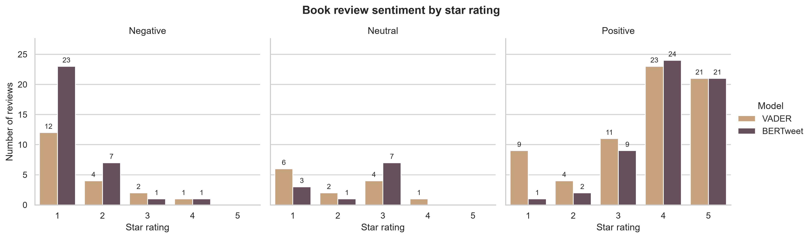

# Book Review Sentiment Analysis

Can we tell how a reader rated a book from the words they used in their review?

In this notebook, I compare two approaches to identifying sentiment in 100 book reviews. VADER uses a dictionary of sentiment scores and a set of rules. BERTweet is a pretrained transformer model that takes the surrounding words into account.

I group readers’ star ratings into three categories (1–2 stars for negative, 3 for neutral, and 4–5 for positive). then I compare each model’s predictions with those categories and examine reviews where the models disagree.

**BERTweet matched the sentiment drived from the star rating for 82 of 100 reviews, compared with 64 for VADER.** The largest difference appeared in one-star reviews. BERTweet labeled 23 of the 27 as negative, while VADER labeled 12 as negative. Both models labeled every five-star review as positive.



[Open the analysis notebook](book-review-sentiment-analysis.ipynb) · [Explore the review sample](data/book_reviews_sample.csv)


## Run locally

From the repository root, create a Python virtual environment.

```bash
python -m venv .venv
```

Activate it using the command for your system.

| System | Activation command |
| --- | --- |
| Windows PowerShell | `.\.venv\Scripts\Activate.ps1` |
| macOS or Linux | `source .venv/bin/activate` |

Install the dependencies and launch JupyterLab.

```bash
python -m pip install -r requirements.txt
jupyter lab
```

Open `book-review-sentiment-analysis.ipynb` and run the cells in order. The first run requires an internet connection to download BERTweet from Hugging Face.
